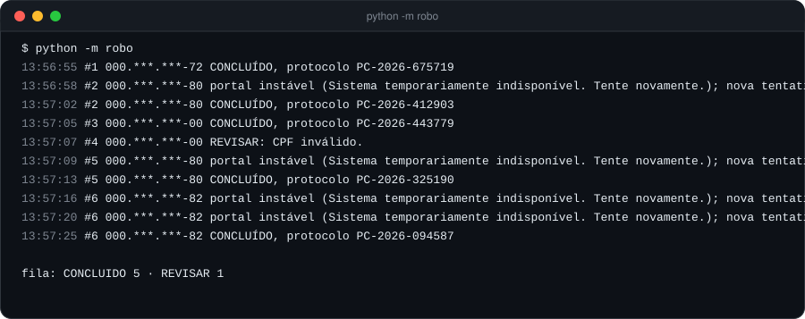

<h1 align="center">Robô de portal web</h1>

<p align="center">
  <b>RPA com Playwright que processa uma fila de cadastros num portal web: novas tentativas quando o portal cai,
  separação entre erro técnico e erro de dado, evidências em print e CPF sempre mascarado no log.</b>
</p>

<p align="center">
  
  
  
  
</p>

---

<p align="center"></p>

## O problema

Cadastrar cliente por cliente num portal externo é repetitivo, e o portal nem sempre colabora: fica lento, cai no meio
do envio, recusa um dado. Um robô ingênuo trava no primeiro erro ou, pior, tenta de novo para sempre um cadastro que
nunca vai passar.

## Como o robô decide

| O que aconteceu | Tipo | O que o robô faz |
|---|---|---|
| Protocolo gerado | sucesso | marca `CONCLUIDO` e guarda o protocolo |
| "CPF inválido", campo faltando | erro de dado | marca `REVISAR` na hora, **sem nova tentativa**, e segue a fila |
| "Sistema indisponível", lentidão | erro técnico | tira um print de evidência e tenta de novo com espera crescente (1 s, 2 s, 4 s) |
| Erro técnico depois de 3 tentativas | erro técnico | marca `ERRO` com o último motivo e segue a fila |

<p align="center"></p>

## Rodando

```bash
git clone https://github.com/EdyVerder/robo-portal-web.git
cd robo-portal-web
python -m pip install -r requirements.txt
python -m playwright install chromium
python -m robo            # sem janela; use --ver para assistir o robô trabalhando
python -m pytest -q       # 7 testes, nenhum abre navegador
```

A demonstração sobe um **portal de mentira** em `127.0.0.1` (pasta [`portal/`](portal)), com login, formulário,
validação de CPF e uma instabilidade proposital (`--instavel 0.25` = 25% dos envios falham). Os clientes são
fictícios e os CPFs começam em `000`.

## Decisões de projeto

- **Page object** ([`robo/portal.py`](robo/portal.py)): seletores, esperas e mensagens do portal ficam num lugar só.
  Quando a tela muda, o conserto é ali.
- **Laço separado do navegador** ([`robo/processar.py`](robo/processar.py)): recebe qualquer objeto com `entrar`,
  `cadastrar` e `evidencia`. Nos testes, um dublê faz o papel do portal, então **nenhum teste abre navegador**.
- **Fila em banco** ([`robo/fila.py`](robo/fila.py)): o robô pode cair e voltar sem repetir o que já fez.
- **Sem segredo no código**: usuário e senha vêm de `PORTAL_USUARIO` e `PORTAL_SENHA`; o log nunca mostra CPF inteiro.
- **Lição que virou teste**: depois de uma recusa, o campo de CPF guardava o valor anterior e a digitação seguinte o
  estragava. O page object agora limpa o campo antes de digitar, e há um teste para isso.

---

<p align="center"><sub>Feito por <a href="https://github.com/EdyVerder">Rocha</a> · portal e clientes fictícios · licença MIT</sub></p>
